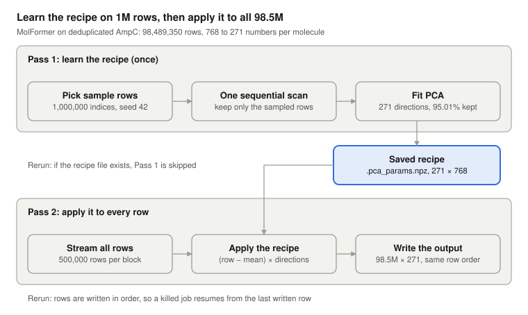

# How pca_reduce_embeddings.py works, using MolFormer as the example

Oct 7, 2026

## What it does

The script shrinks one backbone's embeddings from many numbers per molecule to far fewer, while keeping 95% of the information that distinguishes molecules from each other. For MolFormer on the deduplicated AmpC pool, it turned a 98,489,350 × 768 file into a 98,489,350 × 271 file, keeping 95.01% of the variance, in about 6.6 h on one CPU node (about 3.2 h sampling scan, 19 min fit, 3.0 h transform).

- **Input:** one backbone's embeddings file, one row per molecule (`ampc_99.5M/dedup/molformer_embeddings.npy`).
- **Output:** a narrower file with the same rows in the same order (`ampc_99.5M/dedup_pca/molformer_embeddings.npy`), plus a small saved "recipe" (`.pca_params.npz`).
- **Who uses it:** the active-learning runs read the output exactly like the original embeddings, through `EmbeddingFeaturizer.load()`, so no other code changes.

## The intuition, without math

MolFormer describes every molecule with 768 numbers. Think of them as answers to a 768-question survey about the molecule. Many questions overlap: if two numbers always rise and fall together across molecules, the second one adds almost nothing once you know the first. It is like recording someone's height in both inches and centimetres.

PCA finds a smaller set of "summary questions" that capture most of the real differences between molecules. Each summary question is a fixed weighted mix of the original 768 numbers. The first one captures the biggest pattern of variation across the pool, the second the biggest remaining pattern, and so on. The script keeps adding summary questions until they explain 95% of the total variation.

For MolFormer that took **271 summary questions**. So each molecule is re-described by 271 numbers instead of 768, and the 5% that is dropped is mostly fine detail and noise.

How much a backbone shrinks tells you how much overlap its numbers had. MolFormer kept 35% of its width (271 of 768), so most of its numbers carry independent information. GROVER3400, for contrast, kept under 1% (32 of 3,400): almost all of its numbers restate about 32 underlying patterns.

### Why shrink at all

- **Memory and disk:** the 5-backbone fused vector drops from 6,472 to 653 numbers per molecule (report §14), so files, caches, and per-round reads are about 10× smaller.
- **Speed:** every active-learning round reads embeddings for the whole pool; less data means faster rounds and a smaller labeled-set cache, the cause of earlier memory and disk-quota failures at full width.
- **Cost to accuracy:** on AmpC at 0.4% batch, final recall fell by at most 0.5 points (greedy: 89.4% to 89.1% with 5 backbones; UCB: 93.6% to 93.1% with 6), while rounds took minutes instead of about an hour (report §14).

## At a glance



Pass 1 is the expensive learning step and runs once per backbone; Pass 2 is a cheap, repeated arithmetic step over every row. Both passes read the file front to back, never jumping around.

## Step by step, with MolFormer's numbers

The input is 98,489,350 rows × 768 float32 numbers, about 303 GB on disk. Timings come from job 8274083, task 1.

1. **Pick the sample rows** (`_sample_rows`).
   - What: draw 1,000,000 distinct row numbers at random with `np.random.default_rng(42)`, sort them, and mark them in a true/false array with one entry per row (98.5M bytes).
   - Why a sample: finding the summary directions only needs a good estimate of how the 768 columns vary together. A million random molecules estimate that very well; using all 98.5M would cost far more time and memory and barely change the answer.
   - Size cap: the script uses `min(1,000,000, 1,500,000,000 ÷ 768)` = 1,000,000 rows, so MolFormer is not capped (see design decisions).
2. **Read the sampled rows in one sequential scan.**
   - How: walk the file front to back in 197 blocks of 500,000 rows. For each block, check the true/false array; if any sampled row falls in the block, read the whole block and keep just those rows. About 5,075 sampled rows land in each block, so in practice every block is read.
   - Why read whole blocks: on this storage, one large front-to-back read is much faster than jumping to a million scattered rows. Reading some unneeded rows is the cheaper option.
   - Result: a 1,000,000 × 768 array in memory, about 3.1 GB. Time: about 3.2 h (the last progress line shows 9,485 s at row 80.5M).
3. **Fit PCA** (`_fit_or_load_pca`).
   - How: `PCA(n_components=0.95, svd_solver="full", random_state=42).fit(sample)`.
   - What comes out: `mean_`, the average of each of the 768 columns; and `components_`, 271 rows of 768 weights each, one row per summary direction, ordered from most to least important. Together they explain 95.01% of the variance. Time: 1,159.0 s (19 min).
4. **Save the recipe and set up the output file.**
   - `np.savez` writes `components`, `mean`, and `explained_variance_ratio` to `molformer_embeddings.npy.pca_params.npz`. This file is the whole learned result; nothing else is needed to reduce any MolFormer row later.
   - `preallocate` creates the full output file up front: 98,489,350 × 271 float32, about 107 GB, filled with zeros.
5. **Transform every row** (`reduce_embeddings`).
   - How: read the full file again in 500,000-row blocks. For each block compute `(block − mean_) @ components_.T`, which gives 500,000 × 271, and write it into the same rows of the output with `write_slice`.
   - Why subtract the mean first: the directions were found on data centred at zero, so each new row must be centred the same way before it is projected.
   - Time: 10,844.5 s (3.0 h). The log line says "total", but it only times this step: the timer restarts right before the transform loop.

## Parameters

MolFormer was run by `slurm/embed/ampc/submit_ampc_pca_reduce_embeddings.sh` (array task 1) with the values below; the other four backbones in that job used the same settings except `--dim` and the file names.

| Flag | Meaning | MolFormer value | Why this value |
| --- | --- | --- | --- |
| `--backbone` | Name used in log lines only | `molformer` | Readable logs |
| `--dim` | Numbers per molecule in the input file; checked against the file | `768` | MolFormer's output width; a mismatch stops the job |
| `--n-components` | 1 or more = keep exactly that many directions; below 1 = keep enough to explain that share of variance | `0.95` | Same information target for every backbone, letting each find its own width (MolFormer 271, GROVER3400 32) |
| `--embeddings-path` | Input file | `ampc_99.5M/dedup/molformer_embeddings.npy` | The deduplicated pool the AL runs use |
| `--out-path` | Output file; the recipe is saved next to it as `<out-path>.pca_params.npz` | `ampc_99.5M/dedup_pca/molformer_embeddings.npy` | Separate folder, so raw and reduced files sit side by side |
| `--n-sample` | Rows used to learn the recipe (a fixed count, not a percentage) | `1000000` | Enough to estimate the column relationships well; about 1% of AmpC |
| `--seed` | Random seed for both the row sample and the PCA solver | `42` | Same seed as the rest of the pipeline; reruns pick the same rows |
| `--resume` | Skip finished work: reuse a saved recipe, continue a partly written output | always passed | Safe on every run; a killed job loses nothing |

### Fixed settings inside the script

| Setting | Value | Why |
| --- | --- | --- |
| `READ_BLOCK` | 500,000 rows per read | Large enough for fast front-to-back reads; one MolFormer block is about 1.5 GB in memory |
| `MAX_SAMPLE_ELEMENTS` | 1,500,000,000 numbers | Keeps the fit below a LAPACK size limit that crashed GROVER3400's 3.4-billion-number sample |
| `svd_solver` | `"full"` when `--n-components` is below 1, `"randomized"` when it is a whole number | The randomized solver cannot target a variance share, only a fixed count |

## Design decisions

Most choices trade a little extra reading for much less memory, and favour simple restartable steps over speed.

| Decision | Alternative not taken | Why |
| --- | --- | --- |
| Learn on a sample, then apply to every row | Fit PCA on all 98.5M rows | All rows would need 303 GB in memory for MolFormer; a 1M-row sample gives practically the same directions in 3.1 GB |
| Fixed sample size (1,000,000 rows) | A percentage of the pool | How well the directions are estimated depends on how many rows you have, not what share of the pool they are |
| Read the file front to back and filter | Jump straight to the sampled rows | Scattered reads on this storage have stalled jobs for hours elsewhere in the pipeline; one front-to-back pass is predictable |
| Keep 95% of variance | A fixed width for every backbone | Backbones differ greatly in overlap: the same target gives MolFormer 271 numbers and GROVER3400 32, each sized to its real information content |
| Cap the sample at 1.5 billion numbers | Ask the user to pick a smaller `--n-sample` for wide backbones | The LAPACK limit is invisible until the fit crashes; the cap shrinks only wide backbones (GROVER3400 to 441,176 rows) and leaves MolFormer at 1,000,000 |
| Save the recipe to disk before transforming | Keep it in memory only | A killed job never refits, and every row is reduced with exactly the same recipe even across restarts |
| Create the full output file first, then fill it | Append rows as they are produced | The file has its final size and shape from the start, and unwritten rows are visibly zero, which is what the resume check relies on |
| Resume by searching the output for the last non-zero row | A separate progress file | Rows are written strictly in order, so a binary search over the output finds the restart point in about 27 reads; no extra state to keep in sync |
| One backbone per run | One PCA over all backbones concatenated | Backbones run as parallel array tasks, each file keeps the per-backbone format the AL code reads, and a wide backbone such as GROVER3400 cannot dominate a shared fit |

## Limits and things to watch for

- **A saved recipe is reused even if you change the settings.** If `<out-path>.pca_params.npz` exists, the script loads it without checking `--n-components` or `--n-sample`. To refit with new settings, delete the recipe file and the output file first. `preallocate` refuses to reuse an output file of the wrong width, so a stale output is caught; a stale recipe is not.
- **The "total" time in the last log line covers only the transform.** The whole run is the sampling scan, plus the fit, plus that number. For MolFormer that is about 6.6 h, not 3.0 h.
- **Both full-file passes run in one process, one after the other.** That is fine at AmpC scale but grows with pool size. A row-range parallel version is designed in the 1.3B scaling doc (`docs/scaling_to_1.3B_design.md`).
- **The sampling scan reads almost the whole file** even though only about 1% of rows are kept, because nearly every 500,000-row block contains some sampled rows.
- **Wide backbones silently get a smaller sample.** The cap is printed in the log (`capping sample to ...`) but not otherwise reported; check the log when comparing fits across backbones.
- **Resume assumes no finished row is exactly all zeros.** A reduced row is zero only if the molecule's embedding equals the column means exactly, which in practice does not happen.
- **Row order is preserved, never checked.** The output's row i is the input's row i, so the input must be the same deduplicated file whose order the AL runs and the SMILES library use.

## Deep dive: every step, GROVER3400 vs MolFormer

The two backbones that differ most, side by side, with every number taken from the job logs (jobs 8274083 and 8280815) and the saved recipe and output files. Both use the deduplicated AmpC pool: 98,489,350 rows.

### Parameters, both backbones

| Flag | What it controls | GROVER3400 | MolFormer |
| --- | --- | --- | --- |
| `--backbone` | A label used in log lines only | `grover3400` | `molformer` |
| `--dim` | Input width; the job stops if the file disagrees | `3400` | `768` |
| `--n-components` | A number of 1 or more means "keep exactly this many directions"; a number below 1 means "keep the fewest directions that explain this share of variance" (line 206 converts it to an int when it is 1 or more) | `0.95` | `0.95` |
| `--embeddings-path` | Input file | `ampc_99.5M/dedup/grover3400_embeddings.npy` | `ampc_99.5M/dedup/molformer_embeddings.npy` |
| `--out-path` | Output file; the recipe is saved beside it as `<out-path>.pca_params.npz` | `ampc_99.5M/dedup_pca/grover3400_embeddings.npy` | `ampc_99.5M/dedup_pca/molformer_embeddings.npy` |
| `--n-sample` | Rows requested for learning the recipe (a fixed count) | `1000000` | `1000000` |
| `--seed` | Seeds the random row selection; also passed to PCA | `42` | `42` |
| `--resume` | Reuse a saved recipe and continue a partly written output | on | on |

| Constant | Value | Role |
| --- | --- | --- |
| `READ_BLOCK` (line 48) | 500,000 rows | How many rows are read from disk at once, in both full-file passes |
| `MAX_SAMPLE_ELEMENTS` (line 106) | 1,500,000,000 | Largest sample allowed, counted in individual numbers (rows × width) |
| `svd_solver` (line 117) | `"full"` if `n_components` is a float, `"randomized"` if it is an int | Which SVD routine sklearn uses |

### Step 1: choosing the sample rows

The size cap (lines 106–107):

```python
effective_n_sample = min(n_sample, MAX_SAMPLE_ELEMENTS // dim)
```

| | `1,500,000,000 // dim` | Rows used |
| --- | --- | --- |
| GROVER3400 | 441,176 | 441,176 (capped) |
| MolFormer | 1,953,125 | 1,000,000 (not capped) |

Why the cap exists:

- LAPACK, the linear-algebra library under SciPy, indexes matrices with 32-bit integers here, so it cannot handle a matrix with more than 2³¹ ≈ 2.15 billion numbers.
- GROVER3400 at 1,000,000 rows would be 3.4 billion numbers. That crashed with "integer overflow in LAPACK".
- 1.5 billion leaves margin below the limit. Which backbone gets capped depends only on width, not on redundancy.

Picking the rows (lines 53–57):

```python
rng = np.random.default_rng(seed)
sample_idx = rng.choice(n_total, size=min(n_sample, n_total), replace=False)
sample_idx.sort()
is_sampled = np.zeros(n_total, dtype=bool)
is_sampled[sample_idx] = True
```

- `default_rng(42)` creates a random generator; the same seed always gives the same draw.
- `choice(98,489,350, size, replace=False)` picks that many distinct row numbers.
- `sort()` puts them in file order, so the next step can collect them while reading front to back.
- `is_sampled` is one True/False per row: 98.5M bytes, about 98.5 MB.

The two backbones get different row sets. The seed is the same, but the requested size differs (441,176 vs 1,000,000), so the draw differs. That is fine, because each backbone's PCA is independent.

### Step 2: reading the sampled rows

The loop (lines 62–72):

```python
for start in range(0, n_total, READ_BLOCK):
    end = min(start + READ_BLOCK, n_total)
    block_mask = is_sampled[start:end]
    n_hit = int(block_mask.sum())
    if n_hit:
        block = np.asarray(emb[start:end])
        out[cursor:cursor + n_hit] = block[block_mask]
        cursor += n_hit
```

- **Block count:** 98,489,350 ÷ 500,000 = 196 full blocks plus a final block of 489,350 rows, so 197 blocks.
- **Hits per block:** MolFormer about 5,076 (the log's first block found 5,073); GROVER3400 about 2,240. Every block has hits, so every block is read in full.
- **Why read the whole block:** one large front-to-back read is much faster on this storage than jumping to thousands of scattered rows. The hits are then kept with `block[block_mask]` in memory.

| | One block in memory | Collected sample |
| --- | --- | --- |
| GROVER3400 | 500,000 × 3,400 × 4 bytes ≈ 6.8 GB | 441,176 × 3,400 × 4 bytes ≈ 6.0 GB |
| MolFormer | about 1.5 GB | 1,000,000 × 768 × 4 bytes ≈ 3.1 GB |

Time: GROVER3400 about 12,850 s, MolFormer about 11,600 s. Progress is printed only every 40 blocks, so the last line is at row 80.5M; these times are scaled up from it. That both scans took similar time, although GROVER's file is 4.4× larger, is not explained.

### Step 3: fitting

The call (lines 117–119):

```python
svd_solver = "randomized" if isinstance(n_components, int) else "full"
pca = PCA(n_components=0.95, svd_solver="full", random_state=42)
pca.fit(sample)
```

What `fit` does inside sklearn:

1. Computes each column's average over the sample. That is `mean_`, one number per column.
2. Subtracts it, so every column is centred at zero. This is a copy the same size as the sample.
3. Runs a full SVD, `scipy.linalg.svd(X_centred, full_matrices=False)`, which returns all d directions and their strengths.
4. Each direction's variance is S² / (n − 1); its share of the total is `explained_variance_ratio_`.
5. Keeps the smallest number of leading directions whose shares add up to at least 0.95, and discards the rest.

- **`random_state=42`:** has no effect with `svd_solver="full"`. A full SVD involves no randomness, so the result is fully deterministic.
- **Why `"full"`:** sklearn's randomized solver only accepts a whole-number count, not a variance share. So the full SVD computes all 3,400 GROVER directions, then keeps 32.

Why the times differ: a full SVD on a tall matrix costs about rows × width² (n × d²), not width² alone.

| | Rows | Width | n × d² | Fit time |
| --- | --- | --- | --- | --- |
| GROVER3400 | 441,176 | 3,400 | 5.10 × 10¹² | 10,239 s |
| MolFormer | 1,000,000 | 768 | 5.90 × 10¹¹ | 1,159 s |
| Ratio | 0.44× | 4.4× | 8.65× | 8.83× |

Width alone would make GROVER about 20× slower. The cap cut its rows to 0.44×, so the measured gap is about 9×, matching the n × d² prediction.

How concentrated the variance is, read from the saved recipe files:

| | 1st direction | 2nd | 3rd | Top 3 together | Directions for 95% |
| --- | --- | --- | --- | --- | --- |
| GROVER3400 | 39.3% | 12.6% | 8.6% | 60.4% | 32 of 3,400 (0.94%) |
| MolFormer | 4.0% | 3.3% | 2.4% | 9.7% | 271 of 768 (35.3%) |

GROVER's single strongest direction carries about 10× the variance of MolFormer's. Its 3,400 numbers are dominated by a few strong directions, while MolFormer's variance is spread thinly across many.

### Step 4: saving the recipe

What is saved (lines 125–127):

```python
np.savez(params_path, components=pca.components_, mean=pca.mean_,
         explained_variance_ratio=pca.explained_variance_ratio_)
```

| | `components` | `mean` | `explained_variance_ratio` | File size |
| --- | --- | --- | --- | --- |
| GROVER3400 | 32 × 3,400 float32 | 3,400 | 32 | 449,722 bytes |
| MolFormer | 271 × 768 float32 | 768 | 271 | 837,462 bytes |

The file sizes match the components arrays (32 × 3,400 × 4 = 435,200 bytes; 271 × 768 × 4 = 832,512 bytes). MolFormer's recipe is bigger because it keeps more directions.

- **On a rerun** (lines 79–90): if the recipe file exists, the script builds an empty `PCA` object and fills in `components_` and `mean_` from the file, skipping Steps 1–3. It does not check whether `--n-components` or `--n-sample` changed; delete the recipe file to refit.
- **The output file** (line 172): `preallocate` creates it at its final shape, filled with zeros.

| | Output shape | Size on disk |
| --- | --- | --- |
| GROVER3400 | 98,489,350 × 32 float32 | 12.6 GB |
| MolFormer | 98,489,350 × 271 float32 | 107 GB |

### Step 5: transforming every row

The loop (lines 176–188):

```python
mean_ = pca.mean_
components_T = pca.components_.T              # (d, k)
for start in range(scan_start, n_total, READ_BLOCK):
    block = np.asarray(emb[start:end])         # (500,000, d) read from disk
    reduced = (block - mean_) @ components_T   # (500,000, k)
    write_slice(out_path, start, end, reduced.astype(np.float32, copy=False))
```

- `block - mean_` centres each row exactly as the sample was centred during the fit; skipping it would shift every output value.
- `@ components_T` computes, for every row, how far it sits along each of the k kept directions. Those k numbers are the new embedding.
- `write_slice` writes the 500,000 reduced rows into the same row positions of the output; row i in is always row i out.
- **Resume:** `scan_start` is 0 on a fresh run. If the output exists, `_find_resume_point` binary-searches it for the last non-zero row (about 27 reads for 98.5M rows) and continues from there.

| | Block read | Centred copy | Reduced block |
| --- | --- | --- | --- |
| GROVER3400 | 6.8 GB | 6.8 GB | 64 MB |
| MolFormer | 1.5 GB | 1.5 GB | 542 MB |

Time is set by bytes read, not arithmetic:

| | Multiply-adds per row (d × k) | Bytes read per row | Transform time |
| --- | --- | --- | --- |
| GROVER3400 | 3,400 × 32 = 108,800 | 13,600 | 47,640 s |
| MolFormer | 768 × 271 = 208,128 | 3,072 | 10,845 s |
| GROVER ÷ MolFormer | 0.52× | 4.43× | 4.39× |

MolFormer does about twice the arithmetic per row, yet GROVER took 4.4× longer, the same ratio as the bytes each one reads. Both read their input at about 28 MB/s (1.34 TB in 47,640 s; 303 GB in 10,845 s), so this step is limited by disk reads.

28 MB/s is far below the roughly 1.6 GB/s this pipeline has measured elsewhere on the same filesystem. A likely cause, not yet tested, is the `np.asarray(memmap slice)` read pattern; the ENHITS shuffle job was slow in the same way until it switched to plain buffered file reads. If that holds, the same change could make this step much faster.

### Whole runs

The final log line's "total" covers only the transform; its timer restarts just before the transform loop.

| | Sampling scan | Fit | Transform | Total |
| --- | --- | --- | --- | --- |
| GROVER3400 | about 12,850 s | 10,239 s | 47,640 s | about 70,700 s (19.6 h) |
| MolFormer | about 11,600 s | 1,159 s | 10,845 s | about 23,600 s (6.6 h) |
